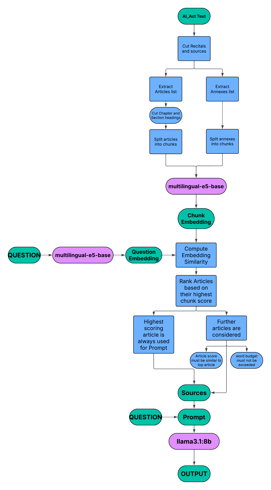
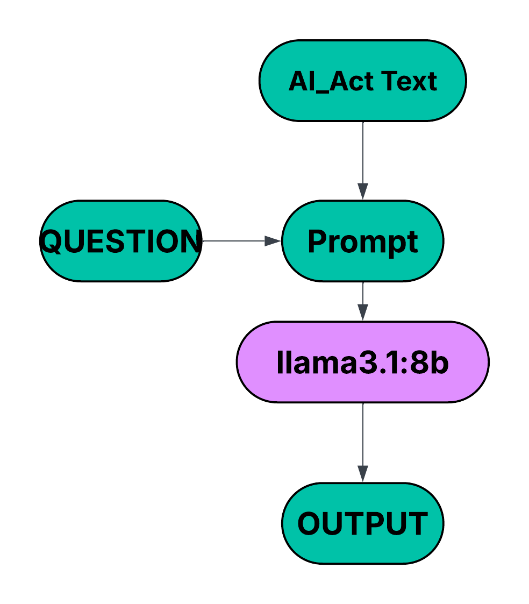
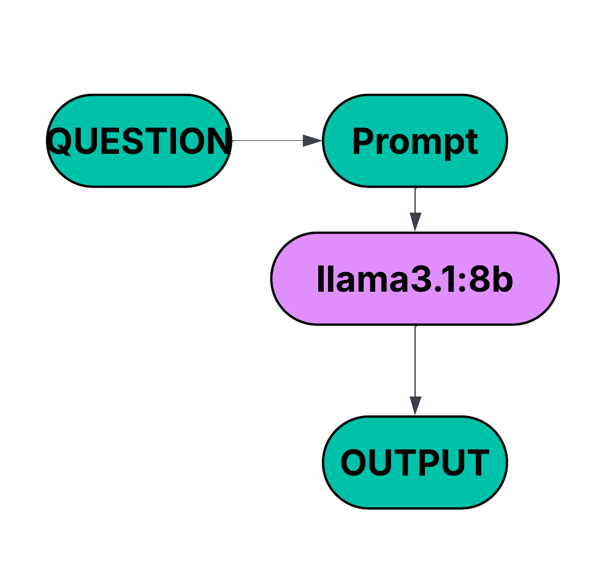
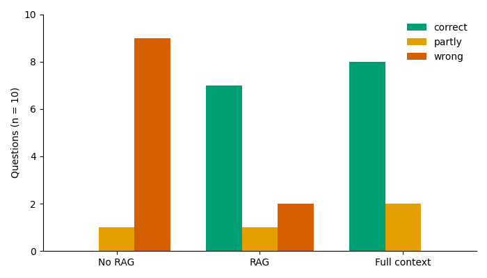
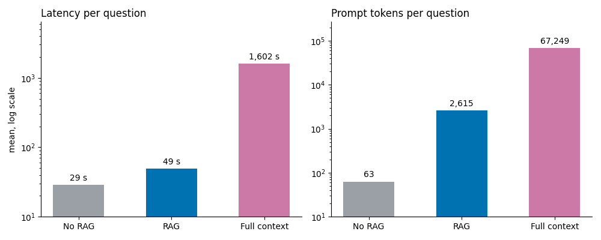

# EU AI Act Compliance Assistant

### In diesem Projekt werden drei Compliance-Assistenten verglichen, die Fragen zum AI Act beantworten (http://data.europa.eu/eli/reg/2024/1689/oj). Die drei Assistenten basieren auf unterschiedlichen Pipelines, die miteinander evaluiert werden.

## Nutzung
1. Installiere die Abhängigkeiten aus `requirements.txt`.
2. Installiere das Modell `llama3.1:8b` lokal über Ollama (oder verwende ein anderes Modell).
3. Führe `ingest.py` aus, wenn sich der zugrunde liegende Text ändert.
4. Passe die Fragen in `questions.jsonl` nach Bedarf an oder übergib Fragen direkt in `answer.py` an die Pipeline.

## Pipeline: mit RAG

**Antworten auf relevante Fragen zum AI Act sollen mithilfe einer Retrieval-Augmented-Generation-Pipeline (RAG) mit Verweisen auf den AI Act ausgegeben werden. Die Pipeline läuft lokal: `multilingual-e5-base` wird für die Suche und `llama3.1:8b` (über Ollama) für die Antwortgenerierung verwendet.**

**Der AI Act wird bereinigt und in Chunks zerlegt, die eingebettet werden und ausschließlich als Suchindex dienen. Der Artikel mit dem höchsten Score wird immer vollständig an das LLM übergeben. Weitere Artikel werden nur hinzugefügt, wenn ihr Score nahe am höchsten Score liegt und das Wortbudget es zulässt.**

## Pipeline: Kompletter AI Act als Quelle

**Antworten auf relevante Fragen zum AI Act sollen mit Verweisen auf den AI Act ausgegeben werden, der in seiner vollständigen Form als Quelle verwendet wird. Die Pipeline läuft lokal: `llama3.1:8b` (über Ollama) wird für die Antwortgenerierung verwendet.**

**Zum Vergleich wird der gesamte bereinigte AI Act (etwa 65.000 Tokens) ohne Retrieval direkt in den Prompt eingefügt.**

## Pipeline: Ohne RAG und Quellen

**Antworten auf relevante Fragen zum AI Act sollen ohne Quellenangaben ausgegeben werden. Die Pipeline läuft lokal: `llama3.1:8b` (über Ollama) wird für die Antwortgenerierung verwendet.**

## Ergebnisse

Die Antworten der Assistenten auf die zehn Fragen (`./eval/questions.jsonl`) wurden manuell anhand des offiziellen AI Act bewertet. Die detaillierten Antworten und Metriken sind in `./eval/results.jsonl` und `results.txt` zu finden. Manuelle Notizen zur Bewertung der einzelnen Fragen stehen am Ende dieser README.

Die folgende Grafik zeigt die Leistung der drei Assistenten. Die Bewertung basiert auf subjektiven Kriterien:

- `correct`: keine Halluzinationen; die Antwort bezieht sich auf die Frage und lässt keine wesentlichen Punkte aus.

- `partly`: richtige Aussagen mit falschen Quellenangaben oder fehlende, aber nicht grundlegende Artikel bzw. Absätze.

- `incorrect`: Halluzinationen, falsche Quellenangaben in Verbindung mit falschen Informationen oder fehlende wesentliche Informationen.

Die folgende Grafik zeigt wichtige Metriken der Pipelines: die gesamte Verarbeitungsdauer und die Anzahl der Tokens.

## Interpretation

### No RAG

- Kürzeste Verarbeitungsdauer

- Halluzinationen, falsche Quellenangaben und fehlende Informationen, die höchstwahrscheinlich auf eine veraltete Version des AI Act zurückzuführen sind

### RAG

- Verarbeitungsdauer nur geringfügig langsamer als bei No RAG, in Einzelfällen sogar schneller

- Meist korrekte Quellenangaben im AI Act (Artikel und Absatz)

- Meist keine Halluzinationen; ehrliche Antwort auf die nicht beantwortbare Frage 10; Vereinzelt ungenaue Antwort bei fehlenden Quellen

- Problem: Wenn ein Artikel in mehrere Chunks aufgeteilt wird, berücksichtigt das Embedding-Modell keinen Kontext. Dadurch verlieren spätere Chunks den Bezug zu den vorherigen. Das kann dazu führen, dass wesentliche Chunks nicht an das LLM weitergegeben werden und das LLM auf Grundlage falscher oder unvollständiger Informationen antwortet (Fragen 6 und 7).

### FULL

- Sehr lange Verarbeitungsdauer, deutlich länger als bei den beiden anderen Pipelines

- Keine Halluzinationen; ehrliche Antwort auf die nicht beantwortbare Frage 10; Antwort zu Frage 8 abgeschnitten da Tokenlimit erreicht

- Häufig fehlen Quellenangaben zum AI Act. Es fehlen insbesondere Absatz- oder Unterabsatznummern, obwohl die Informationen meist korrekt sind (z. B. bei Frage 4).

### Urteil

Die RAG- und FULL-Pipelines erzielen ähnliche Ergebnisse, auch wenn die FULL-Pipeline geringfügig weniger Fehler macht. Die RAG-Pipeline verweist jedoch konsistenter auf den AI Act und benötigt deutlich weniger Verarbeitungszeit als die FULL-Pipeline. Damit erweist sich RAG als wesentlich effizientere Lösung bei vergleichbarer Qualität.

## Limitationen

- **Kleine Stichprobe:** Es gibt nur zehn Fragen, alle auf Englisch und alle zum AI Act. Die Ergebnisse zeigen Tendenzen, aber keine belastbaren Unterschiede zwischen den Pipelines.
- **Subjektive Bewertung:** Die Antworten wurden manuell von einer Person bewertet. Die Kriterien (`correct`, `partly`, `incorrect`) sind nicht streng definiert, und es gibt keine zweite Bewertung zum Vergleich.
- **Ein einziges Modell:** Alle Pipelines verwenden `llama3.1:8b`. Ob die Ergebnisse für größere oder neuere Modelle gelten, ist offen. Besonders die No-RAG-Baseline hängt stark vom Trainingsstand des Modells ab.
- **Retrieval nicht separat bewertet:** Bewertet wurde nur die Endantwort. Die Fehler bei Frage 6, 7 und 8 entstehen, weil der passende Artikel (Art. 113, Anhang III, Art. 51) nicht im Kontext lag. Es fehlt aber eine eigene Retrieval-Metrik, etwa ob der richtige Artikel unter den abgerufenen war.
- **Laufzeiten nur eingeschränkt vergleichbar:** Alle Messungen stammen von einem MacBook Air mit 32 GB RAM. Die absoluten Werte lassen sich nicht übertragen, das Verhältnis zwischen den Pipelines ist aussagekräftiger. Bei Frage 8 wurde die FULL-Antwort bei 1.500 Tokens abgeschnitten.
- **Keine Wiederholungen:** Jede Frage wurde nur einmal gestellt. Die Streuung zwischen mehreren Läufen wurde nicht gemessen.

## Ausblick

- **Besseres Retrieval:** Eine Hybridsuche (BM25 und Embeddings), Query-Rewriting und ein getrennter Index für die Anhänge könnten die fehlenden Artikel bei Frage 6, 7 und 8 abdecken.
- **Agentische Systeme:** Ein Agent könnte selbst prüfen, ob der abgerufene Kontext für die Frage reicht, die Suchanfrage umformulieren und erneut suchen. Er könnte auch Verweisen im Gesetzestext folgen, etwa von Art. 6(2) zu Anhang III, bevor er antwortet. Das würde genau die Fehlerfälle ansprechen, die in dieser Arbeit auftreten.
- **Größerer Fragensatz:** Mit mehr Fragen und Referenzantworten ließe sich die Bewertung stärker standardisieren.

### Manuelle Notizen zur subjektiven Evaluation

Question 1: Which AI practices are prohibited under the AI Act?

--- NONE | 26s | prompt 55 tok | out 315 tok | ctx 4096 ---

Article -> correct (5)

Paragraph -> incomplete ((1) is cited, but only (a) is included)

Hallucinations -> 5(2) - 5(5)

--- RAG | 38s | prompt 3991 tok | out 277 tok | ctx 10240 | retrieved: art5, art50, art2 ---

Article -> correct

Paragraph -> correct, but condensed

Hallucinations -> no

--- FULL | 1319s | prompt 67241 tok | out 295 tok | ctx 88064 ---

Article -> correct

Paragraph -> correct, but condensed; incorrect numbering

Hallucinations -> no

Question 2: How does the AI Act define an 'AI system'?

--- NONE | 19s | prompt 57 tok | out 140 tok | ctx 4096 ---

Article -> correct (3)

Paragraph -> correct (3(1))

Hallucinations -> yes

--- RAG | 52s | prompt 4759 tok | out 91 tok | ctx 10240 | retrieved: art3, art50, art75 ---

Article -> correct (3)

Paragraph -> correct (3(1))

Hallucinations -> no

--- FULL | 1524s | prompt 67243 tok | out 85 tok | ctx 88064 ---

Article -> not cited (the correct Article 3 is used)

Paragraph -> not cited (the correct Article 3(1) is used)

Hallucinations -> no

Question 3: What is the maximum administrative fine for using a prohibited AI practice, and how does it differ for SMEs?

--- NONE | 23s | prompt 67 tok | out 189 tok | ctx 4096 ---

Article -> wrong (cites "Article 58(1)/(2)"; fines are in Art. 99.)

Paragraph -> wrong (99(3) and 99(6) are the right ones)

Hallucinations -> yes: EUR 20M / 4% (should be 35M / 7%), SME figure "10M / 2%" (the Act has no

separate SME amounts), the cited document "2021/C 281/01", and the claim that the regulation

"is still in the proposal phase"

--- RAG | 33s | prompt 2213 tok | out 102 tok | ctx 6144 | retrieved: art99, art100, art101 ---

Article -> correct (Art. 99)

Paragraph -> correct (99(3) for the fine, 99(6) for SMEs)

Hallucinations -> no

--- FULL | 1719s | prompt 67253 tok | out 97 tok | ctx 88064 ---

Article -> correct (Art. 99)

Paragraph -> partly: no paragraph is cited, but the content matches 99(3) and 99(6)

Hallucinations -> no

Question 4: When is an AI system classified as high-risk, and when can an Annex III system be exempt?

--- NONE | 32s | prompt 65 tok | out 256 tok | ctx 4096 ---

Article -> wrong (relevant article is Art. 6)

Paragraph -> wrong (no cited paragraph says what it claims)

Hallucinations -> yes

--- RAG | 77s | prompt 2983 tok | out 433 tok | ctx 8192 | retrieved: art6, annexIII, art7 ---

Article -> correct (Art. 6, plus Art. 7 as a side note)

Paragraph -> correct

Hallucinations -> no

--- FULL | 1807s | prompt 67251 tok | out 311 tok | ctx 88064 ---

Article -> correct (Art. 6), but no paragraph numbers

Paragraph -> the content matches 6(1)–(4), but none of these paragraphs is cited

Hallucinations -> no

Question 5: What are the obligations of deployers of high-risk AI systems?

--- NONE | 35s | prompt 58 tok | out 252 tok | ctx 4096 ---

Article -> wrong (the article is Art. 26)

Paragraph -> wrong

Hallucinations -> yes

--- RAG | 95s | prompt 2626 tok | out 551 tok | ctx 8192 | retrieved: art26, art25, art16 ---

Article -> correct (Art. 26)

Paragraph -> correct: every cited paragraph

Hallucinations -> no

--- FULL | 1481s | prompt 67244 tok | out 102 tok | ctx 88064 ---

Article -> correct (Art. 26)

Paragraph -> no paragraph is cited, but the content matches

Hallucinations -> no

Question 6: From which date does the AI Act apply in general, and which provisions apply

earlier or later?

--- NONE | 18s | prompt 64 tok | out 123 tok | ctx 4096 ---

Article -> wrong (answer is in Art. 113)

Paragraph -> wrong (no paragraph is cited, and the cited articles address different topics)

Hallucinations -> yes; all four dates are incorrect

--- RAG | 43s | prompt 2284 tok | out 216 tok | ctx 6144 | retrieved: art111, art56, art79 ---

Article -> wrong for the main question (Art. 111 is the transitional article, the answer is

in Art. 113, which was not retrieved!!)

Paragraph -> partly

Hallucinations -> yes, applies from 2 August 2027" is wrong

(general date is 2 August 2026!!)&#x20;

PROBLEM: If the embedding retrieves the wrong article, the model does not receive the relevant information in the first place.

--- FULL | 1329s | prompt 67250 tok | out 110 tok | ctx 88064 ---

Article -> correct (Art. 113)

Paragraph -> content correct: general date and items (a)-(c); no lettering

Hallucinations -> no

Question 7: A company uses an AI system to filter job applications and rank candidates.

How is this system classified under the AI Act?

--- NONE | 30s | prompt 69 tok | out 269 tok | ctx 4096 ---

Article -> wrong (the answer is in Annex III, point 4(a), via Art. 6(2))

Paragraph -> wrong

Hallucinations -> yes

--- RAG | 34s | prompt 2373 tok | out 129 tok | ctx 6144 | retrieved: art80, art2, art6 ---

Article -> partly (cites Art. 6(1), which is not the relevant paragraph; Art. 6(2) points to Annex III)

Paragraph -> partly (6(1) is described correctly, but it does not apply to recruitment systems)

Hallucinations -> no. It abstains ("I do not know") and the abstention is faithful to its

prompt: Annex III, where the answer is, was not retrieved. But it is a false negative: the

Act does answer the question

PROBLEM: The embedding stage may not have enough context to link Annex III, point 4(a), to "high-risk".

--- FULL | 1547s | prompt 67255 tok | out 116 tok | ctx 88064 ---

Article -> partly (cites Art. 6(2); the quoted content is from Annex III point 4(a))

Paragraph -> the content is correct, but the location is wrong (it is Annex III, point 4(a), not Art. 6(2))

Hallucinations -> no; the conclusion is correct

Question 8: When is a general-purpose AI model considered to have systemic risk, and what

additional obligations then apply to its provider?

--- NONE | 44s | prompt 68 tok | out 364 tok | ctx 4096 ---

Article -> wrong (the articles are 51, 52 and 55)

Paragraph -> wrong

Hallucinations -> yes

PROBLEM: Trained on an older version of the AI Act.

--- RAG | 40s | prompt 1201 tok | out 270 tok | ctx 6144 | retrieved: art55, art52, art93 ---

Article -> partly (Art. 51 was not retrieved)

Paragraph -> partly (Art. 55 is correct; Art. 51 is missing)

Hallucinations -> partly (it never states what 51(1)(a) says and does not indicate that this part cannot be answered from its sources)

--- FULL | 1996s | prompt 67254 tok | out 1500 tok | ctx 88064 ---

Article -> correct (51, 52, 55 are the right articles)

Paragraph -> partly: the Art. 51 and 55 paragraphs are right; paragraph 52(5) belongs to 52(4) and five 56

paragraphs are mis-numbered and do not suit the question

Hallucinations -> no invented content. Problem: the output reached 1,500 tokens and was cut off mid-sentence.

Question 9: What transparency obligations apply to chatbots and deepfakes?

--- NONE | 24s | prompt 63 tok | out 158 tok | ctx 4096 ---

Article -> wrong (answer is Art. 50)

Paragraph -> wrong (none cited)

Hallucinations -> yes

--- RAG | 60s | prompt 1876 tok | out 409 tok | ctx 6144 | retrieved: art50, art13, art55 ---

Article -> correct (Art. 50; Art. 13 is also included, although it is not relevant; this is optional and harmless)

Paragraph -> correct

Hallucinations -> no

--- FULL | 1662s | prompt 67249 tok | out 554 tok | ctx 88064 ---

Article -> correct (Art. 50; the regulation number 2024/1689 is also correct)

Paragraph -> no paragraph numbers are cited; the content covers 50(1)–(4), but these are not referenced

Hallucinations -> no

Question 10: Does the AI Act give victims a right to financial compensation for damage

caused by an AI system?

--- NONE | 39s | prompt 64 tok | out 310 tok | ctx 4096 ---

Article -> wrong

Paragraph -> wrong (none cited)

Hallucinations -> yes

--- RAG | 21s | prompt 1845 tok | out 24 tok | ctx 6144 | retrieved: art7, art50, art86 ---

Article -> none cited; correct

Paragraph -> none cited; correct

Hallucinations -> no; correct

--- FULL | 1633s | prompt 67250 tok | out 194 tok | ctx 88064 ---

Article -> none cited CORRECT

Paragraph -> none cited CORRECT

Hallucinations -> no
